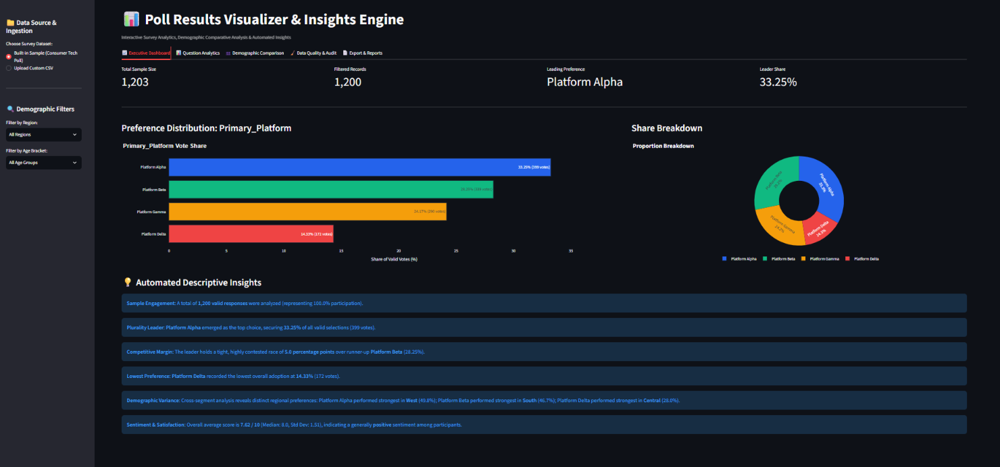
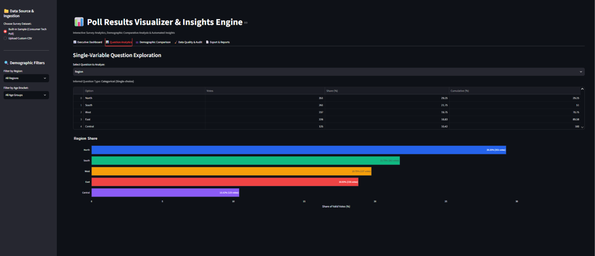
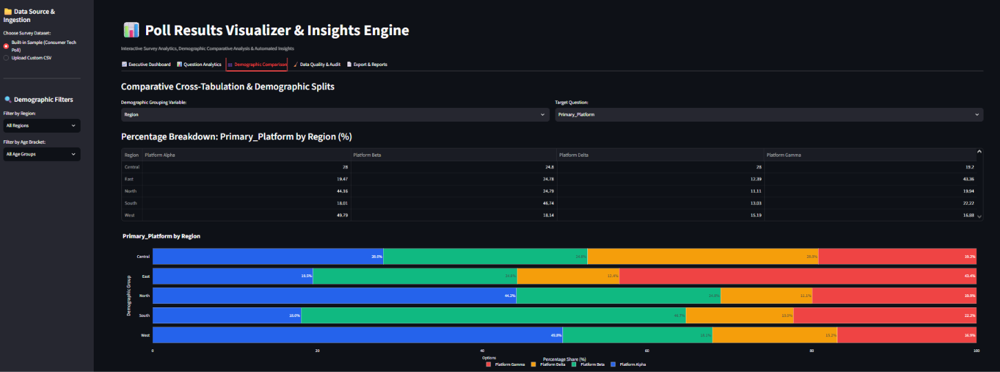
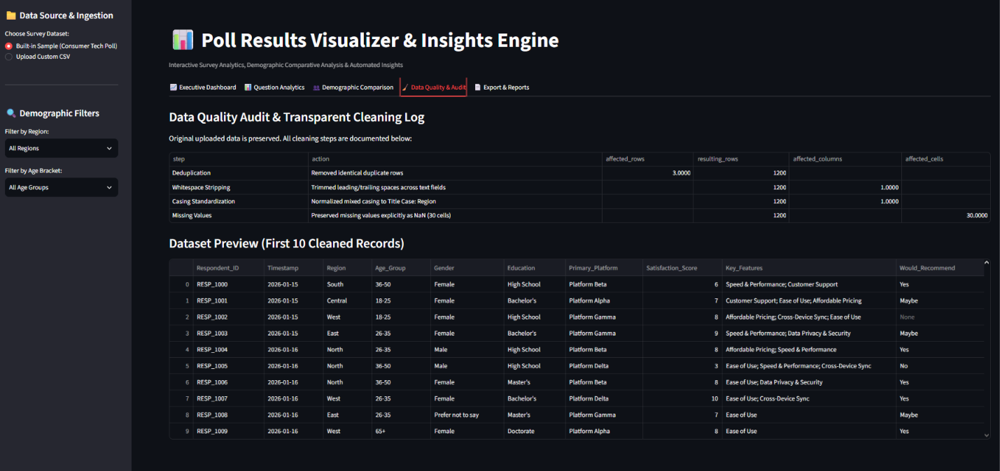

# 📊 Poll Results Visualizer

[](https://www.python.org/)
[](https://streamlit.io/)
[](https://plotly.com/)
[](LICENSE)
[](tests/)

An end-to-end, student-friendly data analytics web application and CLI pipeline that transforms raw survey responses into interactive visualizations, demographic comparative breakdowns, transparent data cleaning audit trails, and automated descriptive insights.

Designed for portfolios targeting **Data Analyst, Business Analyst, Research Analyst, and Insights Analyst** roles.

---

## 🎯 Key Features

1. **Dual Execution Modes**:
   * **Interactive Web Dashboard**: Built with Streamlit, featuring real-time demographic slicers, KPI metric cards, and responsive Plotly figures.
   * **Headless Batch Pipeline**: Run via `python main.py` for automated ETL, statistics computation, image exports, and executive PDF reporting.
2. **Transparent Data Cleaning**:
   * Original raw dataset is preserved immutably.
   * Automated deduplication, whitespace stripping, and casing standardization.
   * Compiles an audit trail documenting affected rows and transformations.
3. **Statistical & Comparative Rigor**:
   * Single-choice percentage share calculations with explicit denominators.
   * Multiple-choice parser distinguishing **Respondent Share** from **Selection Share**.
   * Demographic cross-tabulations (`pd.crosstab`) across regions, age brackets, and genders.
   * Numerical rating descriptive metrics (Mean, Median, Standard Deviation, IQR).
4. **Automated Descriptive Insights**:
   * Natural-language takeaways grounded strictly in calculated statistics (identifying plurality leaders, margins of victory, and regional strongholds).
5. **Multi-Format Reporting**:
   * One-click CSV exports of summary tables and cross-tabs.
   * Publication-ready executive PDF report generation via pure-Python `FPDF2`.

---

## 📸 Application Screenshots & UI Showcase

### 1. Executive Dashboard & KPI Metrics
> High-level survey metrics, interactive Plotly preference distribution bar & donut charts, dynamic sidebar demographic filters, and automated descriptive narrative insights.



---

### 2. Deep-Dive Question Analytics
> Detailed analysis for single-choice, numerical Likert rating distributions, and multi-selection survey questions (% of respondents vs % of total selections).



---

### 3. Demographic & Regional Comparative Analysis
> 100% stacked comparative visualizations breaking down response shares across geographical territories, age cohorts, and education levels.



---

### 4. Transparent Data Quality & Cleaning Audit Trail
> Full audit logging tracking deduplication, whitespace stripping, casing standardization, and missing value preservation.



---

## 🏗️ Architecture & Project Structure

```text
Poll-Results-Visualizer/
│
├── data/
│   ├── poll_survey_data.csv       # 1,200-row synthetic poll dataset
│   └── data_dictionary.md         # Field definitions and codebook
│
├── notebooks/                     # Exploratory analysis workflows
│   └── poll_analysis_walkthrough.ipynb
│
├── src/                           # Modular analytical engine (zero UI dependencies)
│   ├── __init__.py
│   ├── data_generator.py          # Synthetic survey generator with realistic noise
│   ├── validator.py               # Schema, integrity, and type inference
│   ├── cleaner.py                 # Non-destructive cleaning and audit logging
│   ├── analyzer.py                # Frequencies, percentages, cross-tabs, statistics
│   ├── visualizer.py              # Interactive Plotly & static Matplotlib figures
│   ├── insights.py                # Rule-based natural language insight engine
│   └── report_generator.py        # FPDF2 PDF report and CSV exporter
│
├── outputs/                       # Exported summaries and executive PDF reports
│   ├── demographic_crosstab.csv
│   ├── vote_share_summary.csv
│   └── poll_results_executive_report.pdf
│
├── Screenshots/                   # UI dashboard captures and visual proof assets
│   ├── 01_Dashboard.png
│   ├── 02_Analysis.png
│   ├── 03_Demograph.png
│   ├── 04_Data_Quality.png
│   └── poll_results_overview.png
│
├── tests/                         # Pytest automated test suite (11 tests)
│   ├── test_analyzer.py
│   ├── test_cleaner.py
│   └── test_validator.py
│
├── app.py                         # Dedicated Streamlit web dashboard entrypoint
├── main.py                        # Unified CLI and Streamlit entrypoint
├── requirements.txt               # Project dependencies
├── .gitignore                     # Git exclusions
└── README.md                      # Project documentation
```

---

## 🚀 Quick Start Guide

### 1. Prerequisites & Virtual Environment

**Windows (PowerShell)**:
```powershell
# Clone or navigate to the repository
cd "Poll Results Visualize"

# Create a virtual environment
python -m venv venv

# Activate the virtual environment
.\venv\Scripts\Activate.ps1

# Upgrade pip and install dependencies
pip install --upgrade pip
pip install -r requirements.txt
```

**macOS / Linux**:
```bash
# Create and activate environment
python3 -m venv venv
source venv/bin/activate

# Upgrade pip and install dependencies
pip install --upgrade pip
pip install -r requirements.txt
```

---

### 2. Running the Application

#### Option A: Interactive Web Dashboard (Streamlit)
```bash
streamlit run app.py
# or: streamlit run main.py
```
* Opens the responsive browser interface at `http://localhost:8501`.
* Allows uploading custom Google Forms CSV files or loading the built-in sample survey dataset.
* Supports live demographic filtering and one-click PDF/CSV report downloads.

#### Option B: Automated Headless Analytics Pipeline (CLI)
```bash
python main.py
```
* Generates sample survey data (if missing).
* Performs schema validation and data cleaning with an audit trail.
* Computes vote shares, cross-tabs, and descriptive metrics.
* Exports publication-quality static chart PNGs to `images/`.
* Compiles the executive PDF report to `outputs/poll_results_executive_report.pdf`.

---

## 🧪 Running Unit Tests

Run the full automated test suite using `pytest`:
```bash
pytest -v
```

All 11 unit tests validate:
* Exact single-choice percentage calculations.
* Multi-select mention parsing and percentage denominators.
* Deduplication and whitespace trimming logic.
* Data quality audit trail logging.
* Schema and type inference validation.

---

## 📊 Dataset & Simulation Overview

The included dataset simulates a national consumer technology and digital platforms survey:
* **Sample Size**: 1,200 respondents across 5 geographic regions.
* **Demographics**: `Region`, `Age_Group`, `Gender`, `Education`.
* **Target Question**: `Primary_Platform` (`Platform Alpha`, `Platform Beta`, `Platform Gamma`, `Platform Delta`).
* **Rating**: `Satisfaction_Score` (1–10 scale).
* **Multi-Select**: `Key_Features` (semicolon-separated features like *Ease of Use*, *Data Privacy*).

---

## 📄 License
This project is open-source under the [MIT License](LICENSE).
